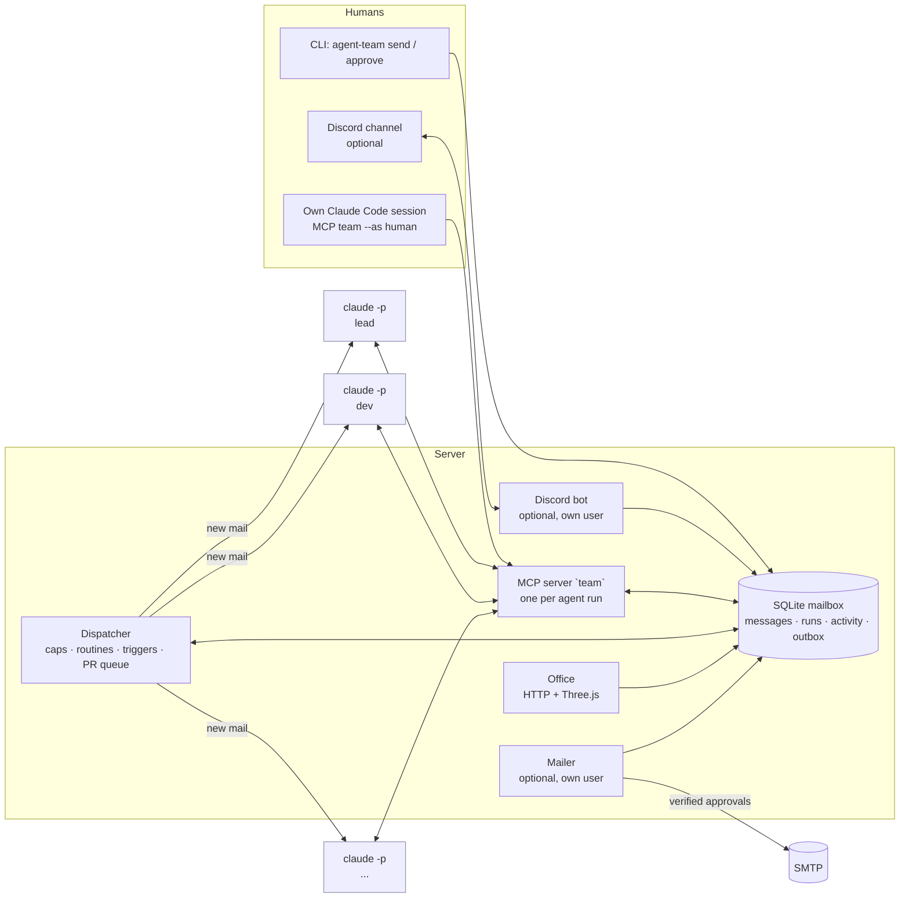

# agent-team

**English** · [Português](#português)

A small company's worth of roles, run by [Claude Code](https://docs.claude.com/en/docs/claude-code) agents. They hand
work to each other through a shared mailbox, review each other's code, and bring the humans only the decisions that
are actually theirs. A 3D "office" shows who is working on what.


*The office playing `examples/tea-shop/replay.json`, a scripted conversation of a made-up tea shop.*

## What it is

- **Roles are configuration.** `team.json` lists the agents (id, name, room, prompt file, allowed tools), the humans,
  who approves what, the orchestrator and the reviewer, plus routines and triggers. The example is a fictional
  two-person online tea shop, *Fern & Kettle*, with a lead, a dev, a reviewer, marketing and support.
- **A mailbox exposed as an MCP server** (`team`): `ask`, `assign`, `reply`, `inbox`, `thread`, `team_log`,
  `post_update`, `share`, `request_approval`, `remember`, `teammates`; optionally `propose_email`/`outbox` and
  `wait_for_pr`. SQLite, standard library only.
- **A dispatcher** that wakes an agent only when it has mail (`claude -p`), so nobody polls and a run takes minutes.
  Conversations a human started go first. Caps per day, per run and on self-started work; pauses on usage limits.
- **Routines and triggers**: scheduled tasks ("Monday 10:00, marketing drafts the newsletter") and "new lines in this
  feed or this command's output become a task" (changelogs, error logs, new support tickets).
- **Human approval**: the rules go into every agent's prompt; `request_approval` reaches the humans; outgoing e-mail is
  enforced by a separate mailer that verifies the approval out of band.
- **Optional integrations, off by default**: Discord (humans talk to the team in a channel, one thread per
  conversation), e-mail over SMTP, GitHub PR review queue.
- **The office** (Three.js): agents walk to their desks when they have work, envelopes fly between them, they go back
  to the kitchen when done. A **replay** mode plays a scripted conversation for demos.

## Architecture



A message to an agent sits in the mailbox until the dispatcher starts `claude -p` for that agent with its role
prompt, the team playbook, the approval rules and the team memory. The agent opens its inbox through the `team` MCP
tools, works (in your repository, with the tools its role allows), asks or assigns teammates and replies. Each run
handles one conversation and ends; answers wake whoever is waiting.

| File | What it does |
|---|---|
| `agent_team/config.py` | settings (env / `.env`) and `team.json` loading and validation |
| `agent_team/store.py` | the mailbox (SQLite), file checks, approval helpers |
| `agent_team/mcp_server.py` | the `team` MCP server (stdio JSON-RPC) |
| `agent_team/dispatcher.py` | wakes agents; heartbeat, routines, triggers, caps, GitHub PR queue |
| `agent_team/office.py`, `office.html` | the office (HTTP + Three.js) and its access rules |
| `agent_team/replay.py` | plays a scripted conversation into a throwaway database |
| `agent_team/mailer.py` | optional: sends human-approved e-mail over SMTP |
| `agent_team/discord_bot.py`, `notify.py` | optional: Discord bot and mirror |
| `examples/tea-shop/` | the fictional example team: `team.json`, prompts, `TEAM.md`, `replay.json` |
| `deploy/` | example systemd install (separate OS users per service) |

## Run it locally

Requirements: Python 3.9+ (standard library only), and [Claude Code](https://docs.claude.com/en/docs/claude-code)
for real runs. `discord.py` only if you enable the Discord bot.

```bash
git clone <this repository> agent-team && cd agent-team
cp .env.example .env              # TEAM_DRY_RUN=1: no Claude calls yet

python3 -m agent_team check       # validates examples/tea-shop/team.json
python3 -m unittest discover -s tests   # smoke tests, no network

# 1. The office with the scripted demo (nothing real): http://127.0.0.1:8130
python3 -m agent_team office --replay examples/tea-shop/replay.json

# 2. The loop in dry-run: a stub answers instead of Claude
python3 -m agent_team send "Can we add an autumn bundle by Friday?"
python3 -m agent_team dispatcher            # Ctrl-C to stop
python3 -m agent_team log                   # what happened
python3 -m agent_team office                # live office on the real mailbox
```

For real runs: log in to Claude Code (`claude setup-token` or an API key), point `TEAM_WORKDIR` to your project, set
`TEAM_DRY_RUN=0`, and start the dispatcher. Talk to the team with `agent-team send`, from your own Claude Code
session (`python3 -m agent_team mcp-config --as ana` prints the MCP entry; then "ask lead …", "what did the team do
today?"), or from Discord.

**Your own team:** copy `examples/tea-shop/`, edit `team.json` (roles, humans, approval rules, routines, triggers)
and the prompts, set `TEAM_CONFIG`, and run `agent-team check`. `agent-team prompt <agent>` shows exactly what an
agent is told.

## Security

Read [SECURITY.md](SECURITY.md). In short:

- **Human approval.** Approval rules are part of every agent's instructions; `request_approval` routes the question to
  the humans. E-mail is enforced: the mailer sends only what a human approved, verified with an HMAC
  (`agent-team approve`) or against Discord's API, and only if the email is unchanged.
- **Sandbox.** Run agents as their own OS user, in a container or VM, with only the repository they work on.
  `TEAM_PERMISSION_MODE=default` + per-role `allowed_tools` by default; `bypassPermissions` only inside a sandbox.
- **Secrets.** Never in `team.json`, prompts or the repo: `.env` (ignored by git) or per-service env files readable
  only by that service's user. The mailbox is not an auth boundary; agents must not be able to read the mailer's or
  the bot's secrets. Attachments are checked (no dotfiles, keys or env files).
- **Budgets and a stop button.** Parallel runs, daily caps, a timeout per run, `agent-team stop`.

## Limitations

- Built for **Claude Code** (`claude -p`, stream-json output, MCP). Other agent CLIs would need a new runner.
- **One machine**: SQLite, threads, no queue. Fine for a small team; not a distributed system.
- **Prompt injection is not solved.** Agents read untrusted text; the defenses are least privilege and human approval
  for side effects, not detection.
- **Soft approvals.** Except e-mail, approvals are instructions the agent follows, not enforced gates. Enforce new
  side effects the way the mailer does.
- The dry run checks the plumbing, not the agents' judgment. Quality depends on your prompts and playbook.
- The office loads Three.js and fonts from public CDNs; it needs a browser with WebGL.
- GitHub integration needs `gh` logged in and only knows PRs and checks. The Discord bot is lightly tested.
- Early, small codebase (v0.1). Expect breaking changes.

## License

MIT, see [LICENSE](LICENSE).

---

# Português

[English](#agent-team) · **Português**

Os papéis de uma pequena empresa, ocupados por agentes do [Claude Code](https://docs.claude.com/en/docs/claude-code).
Eles passam trabalho entre si por uma caixa de correio compartilhada, revisam o código um do outro e só levam às
pessoas as decisões que são de fato delas. Um "escritório" em 3D mostra quem está trabalhando em quê.

## O que é

- **Papéis são configuração.** O `team.json` lista os agentes (id, nome, sala, arquivo de prompt, ferramentas
  permitidas), as pessoas, quem aprova o quê, o orquestrador e o revisor, além de rotinas e gatilhos. O exemplo é uma
  loja online de chá fictícia, a *Fern & Kettle*, com lead, dev, revisor, marketing e atendimento.
- **Uma caixa de correio exposta como servidor MCP** (`team`): `ask`, `assign`, `reply`, `inbox`, `thread`,
  `team_log`, `post_update`, `share`, `request_approval`, `remember`, `teammates`; opcionalmente
  `propose_email`/`outbox` e `wait_for_pr`. SQLite, só biblioteca padrão.
- **Um dispatcher** que acorda um agente só quando ele tem mensagem (`claude -p`): ninguém faz polling e cada execução
  leva minutos. Conversas iniciadas por uma pessoa passam na frente. Limites por dia, por execução e para trabalho
  que o time inicia sozinho; pausa quando bate o limite de uso.
- **Rotinas e gatilhos**: tarefas agendadas ("segunda 10h, marketing rascunha a newsletter") e "linhas novas neste
  feed ou na saída deste comando viram tarefa" (changelogs, logs de erro, tickets novos de atendimento).
- **Aprovação humana**: as regras entram no prompt de todo agente; `request_approval` chega às pessoas; o e-mail que
  sai é garantido por um mailer separado que confere a aprovação por fora.
- **Integrações opcionais, desligadas por padrão**: Discord (as pessoas falam com o time num canal, uma thread por
  conversa), e-mail por SMTP, fila de revisão de PRs no GitHub.
- **O escritório** (Three.js): os agentes vão até a mesa quando têm trabalho, envelopes voam entre eles, e voltam para
  a copa quando terminam. O modo **replay** reproduz uma conversa roteirizada para demonstração.

## Arquitetura

O diagrama está na seção em inglês, acima. Uma mensagem para um agente fica na caixa até o dispatcher rodar
`claude -p` para ele, com o prompt do papel, o manual do time (`TEAM.md`), as regras de aprovação e a memória do
time. O agente abre a caixa pelas ferramentas MCP `team`, trabalha (no seu repositório, com as ferramentas que o
papel permite), pergunta ou passa tarefas aos colegas e responde. Cada execução trata uma conversa e termina; a
resposta acorda quem estava esperando. A tabela de arquivos também está acima.

## Como rodar local

Requisitos: Python 3.9+ (só biblioteca padrão) e, para execuções de verdade, o Claude Code. `discord.py` só se ligar
o bot do Discord.

```bash
git clone <este repositório> agent-team && cd agent-team
cp .env.example .env              # TEAM_DRY_RUN=1: ainda sem chamar o Claude

python3 -m agent_team check       # valida examples/tea-shop/team.json
python3 -m unittest discover -s tests   # testes de fumaça, sem rede

# 1. O escritório com a demonstração roteirizada (nada real): http://127.0.0.1:8130
python3 -m agent_team office --replay examples/tea-shop/replay.json

# 2. O ciclo em modo seco: um stub responde no lugar do Claude
python3 -m agent_team send "Dá para lançar um kit de outono até sexta?"
python3 -m agent_team dispatcher            # Ctrl-C para parar
python3 -m agent_team log                   # o que aconteceu
python3 -m agent_team office                # escritório ao vivo, na caixa real
```

Para valer: faça login no Claude Code (`claude setup-token` ou chave de API), aponte `TEAM_WORKDIR` para o seu
projeto, `TEAM_DRY_RUN=0` e suba o dispatcher. Fale com o time por `agent-team send`, pela sua própria sessão do
Claude Code (`python3 -m agent_team mcp-config --as ana` imprime a entrada do MCP) ou pelo Discord. Para usar o time
em português, `"language": "pt"` no `team.json` (mensagens às pessoas e a interface do escritório).

**O seu time:** copie `examples/tea-shop/`, edite o `team.json` e os prompts, aponte `TEAM_CONFIG` e rode
`agent-team check`. `agent-team prompt <agente>` mostra exatamente o que o agente recebe.

## Segurança

Leia o [SECURITY.md](SECURITY.md). Em resumo:

- **Aprovação humana.** As regras fazem parte das instruções de todo agente; `request_approval` leva a pergunta às
  pessoas. No e-mail é obrigatório: o mailer só envia o que uma pessoa aprovou, conferido por HMAC
  (`agent-team approve`) ou pela API do Discord, e só se o e-mail não mudou.
- **Sandbox.** Rode os agentes com usuário próprio do sistema, em container ou VM, só com o repositório em que
  trabalham. Padrão: `TEAM_PERMISSION_MODE=default` + `allowed_tools` por papel; `bypassPermissions` só dentro de sandbox.
- **Segredos.** Nunca no `team.json`, nos prompts ou no repositório: `.env` (ignorado pelo git) ou arquivos de
  ambiente por serviço, legíveis só pelo usuário daquele serviço. A caixa de correio não é fronteira de segurança;
  os agentes não podem conseguir ler os segredos do mailer e do bot. Anexos são conferidos (sem dotfiles, chaves ou .env).
- **Limites e botão de parar.** Execuções paralelas, limites diários, timeout por execução, `agent-team stop`.

## Limitações

- Feito para o **Claude Code** (`claude -p`, saída stream-json, MCP). Outros CLIs de agente pediriam outro executor.
- **Uma máquina só**: SQLite, threads, sem fila. Serve para um time pequeno; não é sistema distribuído.
- **Prompt injection não está resolvido.** Os agentes leem texto não confiável; a defesa é menor privilégio e
  aprovação humana para efeitos externos, não detecção.
- **Aprovações "macias".** Fora o e-mail, aprovação é instrução que o agente segue, não trava obrigatória. Novos
  efeitos externos devem ser garantidos do jeito que o mailer faz.
- O modo seco testa o encanamento, não o julgamento dos agentes. A qualidade depende dos prompts e do manual.
- O escritório carrega Three.js e fontes de CDNs públicas; precisa de navegador com WebGL.
- A integração com GitHub precisa do `gh` logado e só conhece PRs e checks. O bot do Discord foi pouco testado.
- Código pequeno e inicial (v0.1). Espere mudanças incompatíveis.

## Licença

MIT, veja [LICENSE](LICENSE).
