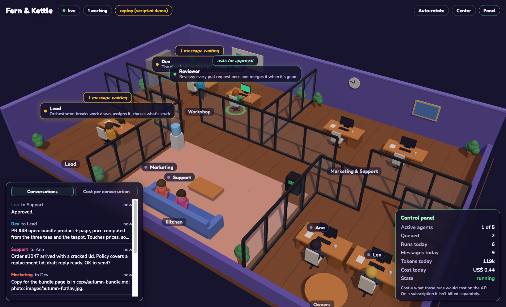
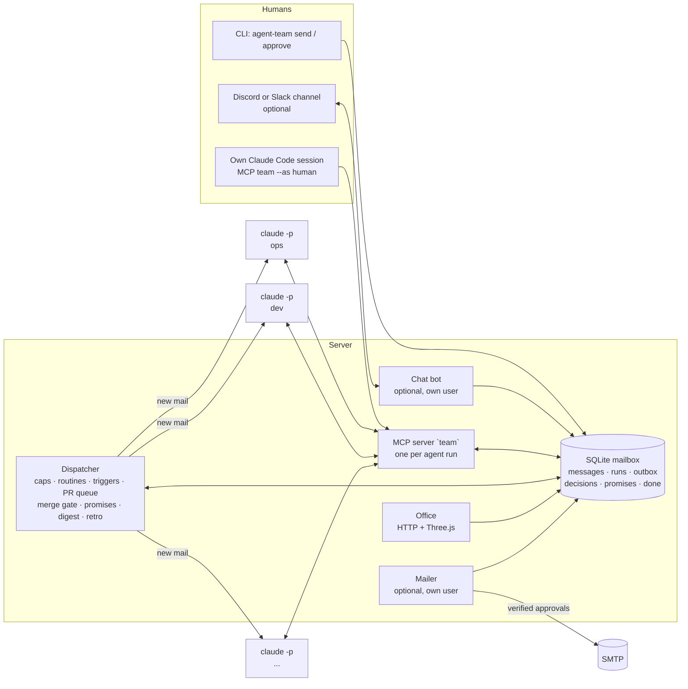

# agent-team

**English** · [Português](#português)

A small company's worth of roles, run by [Claude Code](https://docs.claude.com/en/docs/claude-code) agents. They hand
work to each other through a shared mailbox, review each other's code, and bring the humans only the decisions that
are actually theirs. A 3D "office" shows who is working on what.



*The office playing `examples/tea-shop/replay.json`, a scripted conversation of a made-up tea shop.*

## What it is

- **Roles are configuration.** `team.json` lists the agents (id, name, room, prompt file, allowed tools), the humans,
  who approves what, the orchestrator and the reviewer, plus routines and triggers. The example is a fictional
  two-person online tea shop, *Fern & Kettle*, with an orchestrator (Ops), a dev, a reviewer, marketing, support and
  a weekly retro.
- **A mailbox exposed as an MCP server** (`team`): `ask`, `assign`, `reply`, `inbox`, `thread`, `team_log`,
  `post_update`, `share`, `request_approval`, `commit`/`commit_done`/`commit_failed` (promises), `remember`,
  `teammates`; `decide` for whoever relays a human's answer; optionally `propose_email`/`outbox`, `review` and
  `wait_for_pr`. SQLite, standard library only.
- **An optional orchestrator** (see below): one agent is the humans' only door, an authority ladder says what the team
  decides alone, approvals are transactions with a receipt, promises are registered, and the day ends in one digest.
- **A dispatcher** that wakes an agent only when it has mail (`claude -p`), so nobody polls and a run takes minutes.
  Conversations a human started go first. Caps per day, per run and on self-started work; pauses on usage limits.
- **Routines and triggers**: scheduled tasks ("Monday 10:00, marketing drafts the newsletter") and "new lines in this
  feed or this command's output become a task" (changelogs, error logs, new support tickets).
- **Human approval**: the rules go into every agent's prompt; `request_approval` reaches the humans; outgoing e-mail is
  enforced by a separate mailer that verifies the approval out of band.
- **Pluggable integrations, off by default**: chat on **Discord or Slack** (humans talk to the team in a channel,
  one thread per conversation, @mentions when an agent needs them), knowledge in a **Markdown folder (an Obsidian
  vault works) or Notion** (agents read the humans' notes, the team writes a note a day back), e-mail over SMTP,
  GitHub PR review queue, merge gate, deploy train and post-deploy checks.
- **The office** (Three.js): agents walk to their desks when they have work, envelopes fly between them, they go back
  to the kitchen when done. A "Done today" tab lists what got done and why (asked by a human, routine, initiative).
  A **replay** mode plays a scripted conversation for demos.

## The orchestrator (optional)

Without these keys a team works as in v0.1: a message without a name goes to `orchestrator` (the first role by
default), an answer inside a chat thread goes to whoever spoke last there, and `share` reaches the humans at once.
Each feature below is off until its key is in `team.json`; the example turns them all on.

| Key | What it does |
|---|---|
| `orchestrator` + `"single_door": true` | Every human message without a name goes to the orchestrator, inside a chat thread too. It routes the work, resolves the humans' answers against what's pending in that conversation (asking in one line when "approve" could mean two things), records them with `decide`, and closes every request with one receipt: done + proof, couldn't + why, or promised by when. Agents answer whoever asked them, not the humans. |
| `authority` | `levels` (0: the agent, 1: the orchestrator or a lead, 2: a human, not urgent, 3: a human, now; names and examples are yours), `rules` (the higher level wins in doubt, precedents, a trust ladder) and `locks` (what nobody changes without a human, the retro included). Rendered into every agent's instructions. `remember` with `precedent: true` turns a human's answer into a standing rule. |
| `decision_kinds` | The kinds `request_approval` accepts (default `pr`, `spend`, `legal`, `other`). Every request opens a row in `decisions`; `pr` needs the PR number, and the merge gate waits for it. |
| `promises` | `commit(what, due, depends)` registers "I'll do it later"; the dispatcher wakes the agent in the same conversation when `depends` closes (`pr:<n>` merged, `decision:<id>` decided) or at `due`, and tells the orchestrator once when it's `chase_after_min` (120) overdue. With `require` (default: on with a single door) the tools refuse "I'll let you know when…" without a promise. |
| `digest` | `{"at": "19:00", "days": [...]}`. `share` gets an `urgent` flag; anything else waits for one daily message assembled by code from the tables (done, found, decided, waiting for you, open promises, cost) and posted as the orchestrator. `agent-team digest` prints today's. |
| `merge_gate` | With `TEAM_GITHUB=1` and a `reviewer`: the reviewer only reviews (`review` ok / ok + needs a human / block), and the dispatcher merges an ok PR when CI is green on that same commit, no decision for it is pending or was rejected since the review, `sensitive_paths` (regexes) have a human's yes, and `deploy_workflow` (optional) isn't running; one a minute, with a receipt in the human's thread. |
| `heartbeat.when` | `"backlog"`: the heartbeat runs only when a PR has been open for more than a day or a new issue appeared (needs GitHub); `{why}` in its prompt says which. Default `"always"`. |
| `retro` | `{"agent", "days": [0], "at": "08:30", "max_changes": 3, "notes_dir"}`: a weekly task with the data to read (the mailbox, read-only) and what to measure (receipts, promises, approvals, cost per result), at most N changes by PR, each waiting for a human, never touching the `locks`. |

The humans can also answer from the command line: `agent-team decisions`, `agent-team decide <id> approve|reject`,
`agent-team promises`. In the chat, a plain "approve" in a thread where a PR (or any decision) and emails both wait
approves no email: the bot says it's ambiguous and the orchestrator asks; "approve the emails" or the email numbers do
it, and bare numbers count only when they are pending email ids.

## v0.3: integrations and shipping (optional)

Each block below is off until its key is in `team.json`; the tea-shop example turns them on. Secrets only ever come
from the environment (see `.env.example`).

| Key | What it does |
|---|---|
| `chat` | `{"provider": "discord" \| "slack" \| "none", "mention": true}`. Same behavior on both: what agents say to a human shows up in one thread per conversation (the team's own initiatives share one thread a day), posted under the agent's name; a human is @mentioned when a message asks or answers them (status updates don't ping); approvals in a thread are re-read from the chat's API by the mailer before an email leaves. Discord: webhook + bot (`agent-team discord-bot`, needs `discord.py`). Slack: a bot token, and `agent-team slack-bot` over Socket Mode (`slack_sdk`, no public URL) or the Events API (standard library, signed requests only). |
| `knowledge` | `{"provider": "markdown", "path", "read", "daily_dir", "git"}` or `{"provider": "notion", "read", "daily_parent" \| "daily_database"}`. The `read` notes go into every agent's instructions; `notes_search` / `notes_read` find the rest. At `daily_at` (23:50) the dispatcher writes the day's note (done, decided, waiting, promises, cost) from the tables; with `git: true` it commits and pushes that file alone. `agent-team daily-note --print` shows it. |
| `models` | `{"human": "<model>", "light_review": "<model>", "human_except": [...]}`: the strong model for conversations a human started, a cheaper one for reviews that only touch `review.light_paths`; otherwise each role's own `model`. The model of every run is recorded. |
| `review` | `{"guide": "REVIEW.md", "max_rounds": 3, "overlap": true, "light_paths", "skip_branches", "fallback_owner"}`. After round 1 the reviewer looks only at what changed since its last block; at the cap it stops listing lines and sends the author back to the approach. A PR touching most of the same files as an open PR or one merged in the last day is flagged as a likely duplicate or fix-of-a-fix. |
| `prompt_eval` | Needs `merge_gate`. A PR that changes prompts (`paths`) runs real agents on real situations (`cases`, a JSON file in the repo) in a sandbox, on the PR and on the base: a case that passes on the base and fails on the PR blocks the merge and goes back to the author. Incident cases (`"score": true`) run 3x and report a score when the reviewer's own prompt changes. A changed line matching `locked` needs a human. See `agent_team/evals.py`. |
| `retro.self_merge` | With `prompt_eval`: the retro's PRs merge like any other (reviewer + eval) instead of each waiting for a human; locked rules still ask one. |
| `north` | `{"days": [0], "at": "09:15", "agent"}`: weekly, the orchestrator measures last week's goals and sets 1-3 for this one (`set_north`). Every run sees them; work the team starts on its own must say which goal it serves or stop ("off north"), maintenance excepted (`"maintenance": true` on a routine or trigger). |
| `deploy` | `{"workflow": "deploy.yml", "every_min": 30, "skip_paths"}` batches deploys (at once for a revert or a PR a human waits for; never for docs only), or `"on_merge": true` when the platform deploys every merge. `verify`: `after_min` after each deploy the `site`'s `paths` and the pages the deploy changed (`page_map`) must answer and `logs_command` must show no new error shape; broken → a revert PR the gate merges on green, the evidence to the author, the humans @mentioned if the site is down. A promise that `depends` on `pr:<n>` closes when it's deployed. |
| `conflicts` | `{"close_after_h": 24, "union_files": ["CHANGELOG.md"], "check": [...]}`: a conflicting PR gets a rebase task for its author once per commit; conflicts only in `union_files` are resolved by the dispatcher itself (both sides kept, `check` run, force-with-lease); 24 h later on the same commit the PR is closed, branch kept. |
| `alerts` | `{"names": ["Uptime monitor"], "agent": "ops"}`: a webhook or bot with that name posting in the channel (or `agent-team alert "…"` from a cron job) opens a task for the orchestrator, whose reply goes back to the humans in that thread. |
| `stand_ins` | `{"designer": "marketing"}`: messages and routines for a role this team doesn't have go to the one that covers it, so several teams can share prompts and routines. |
| `jobs_off`, `backup`, `office` | Turn dispatcher jobs off by name; keep N daily copies of the mailbox (`backup.keep`, default 7); per-team office `title`, `back` link, `prefix` and `css` colors. |

**More than one team on a host:** one `team.json`, data dir and office port per team, and the templated units
`agent-team-dispatcher@<team>` / `agent-team-office@<team>` (each reads `/etc/agent-team/teams/<team>.env`).

**Tests never touch a real mailbox:** under `unittest`, opening a database outside the temp dir raises.

## Architecture



A message to an agent sits in the mailbox until the dispatcher starts `claude -p` for that agent with its role
prompt, the team playbook, the approval rules and the team memory. The agent opens its inbox through the `team` MCP
tools, works (in your repository, with the tools its role allows), asks or assigns teammates and replies. Each run
handles one conversation and ends; answers wake whoever is waiting.

| File | What it does |
|---|---|
| `agent_team/config.py` | settings (env / `.env`) and `team.json` loading and validation |
| `agent_team/store.py` | the mailbox (SQLite), file checks, approvals, decisions, promises, the done ledger |
| `agent_team/mcp_server.py` | the `team` MCP server (stdio JSON-RPC) |
| `agent_team/dispatcher.py` | wakes agents; heartbeat, routines, triggers, caps, GitHub PR queue, merge gate, promises, digest, retro |
| `agent_team/office.py`, `office.html` | the office (HTTP + Three.js) and its access rules |
| `agent_team/replay.py` | plays a scripted conversation into a throwaway database |
| `agent_team/mailer.py` | optional: sends human-approved e-mail over SMTP |
| `agent_team/notify.py`, `agent_team/chat/` | the chat mirror and its providers (`discord.py`, `slack.py`), the bots (`discord_bot.py`, `slack_bot.py`) and their shared rules (`inbound.py`) |
| `agent_team/knowledge/`, `daily.py` | the notes providers (`markdown.py`, `notion.py`) and the daily note |
| `agent_team/ship.py` | after the merge: deploy train, post-deploy verification and revert, conflicts |
| `agent_team/evals.py` | prompt evals (`agent-team eval`) |
| `examples/tea-shop/` | the fictional example team: `team.json`, prompts, `TEAM.md`, `replay.json` |
| `deploy/` | example systemd install (separate OS users per service) |

## Run it locally

Requirements: Python 3.9+ (standard library only), and [Claude Code](https://docs.claude.com/en/docs/claude-code)
for real runs. `discord.py` only for the Discord bot, `slack_sdk` only for Slack's Socket Mode.

```bash
git clone <this repository> agent-team && cd agent-team
cp .env.example .env              # TEAM_DRY_RUN=1: no Claude calls yet

python3 -m agent_team check       # validates examples/tea-shop/team.json
python3 -m unittest discover -s tests   # smoke tests, no network

# 1. The office with the scripted demo (nothing real): http://127.0.0.1:8130
python3 -m agent_team office --replay examples/tea-shop/replay.json

# 2. The loop in dry-run: a stub answers instead of Claude
python3 -m agent_team send "Can we add an autumn bundle by Friday?"
python3 -m agent_team dispatcher            # Ctrl-C to stop
python3 -m agent_team log                   # what happened
python3 -m agent_team office                # live office on the real mailbox
```

For real runs: log in to Claude Code (`claude setup-token` or an API key), point `TEAM_WORKDIR` to your project, set
`TEAM_DRY_RUN=0`, and start the dispatcher. Talk to the team with `agent-team send`, from your own Claude Code
session (`python3 -m agent_team mcp-config --as ana` prints the MCP entry; then "ask ops …", "what did the team do
today?"), or from Discord or Slack.

**Slack in five steps:** create an app (from scratch) in your workspace; add the bot scopes `chat:write`,
`chat:write.customize`, `channels:history`, `files:read`, `files:write`, `reactions:write`, `users:read`; either
enable Socket Mode (an app-level token with `connections:write` → `SLACK_APP_TOKEN`) or set the Events API Request
URL to `https://<your host>/slack/events` (→ `SLACK_SIGNING_SECRET`); subscribe to `message.channels`; install it, invite
the bot to the channel, and set `SLACK_BOT_TOKEN`, `SLACK_CHANNEL` and `TEAM_SLACK_USERS` (`U…:ana,U…:leo`). Then
`"chat": {"provider": "slack"}` and `agent-team slack-bot`.

**Notion in three steps:** create an internal integration (→ `NOTION_TOKEN`), share with it the pages the team may
read and the page (or database) where daily notes go, and put their ids in `knowledge.read` and
`knowledge.daily_parent` (or `daily_database`).

**Your own team:** copy `examples/tea-shop/`, edit `team.json` (roles, humans, approval rules, routines, triggers)
and the prompts, set `TEAM_CONFIG`, and run `agent-team check`. `agent-team prompt <agent>` shows exactly what an
agent is told.

## Security

Read [SECURITY.md](SECURITY.md). In short:

- **Human approval.** Approval rules (and the authority levels) are part of every agent's instructions;
  `request_approval` opens a decision for the humans. E-mail is enforced: the mailer sends only what a human approved,
  verified with an HMAC (`agent-team approve`) or against the chat's API (Discord or Slack), and only if the email is
  unchanged.
- **The merge gate** is code: the dispatcher never merges around a pending or rejected decision, a red or unfinished
  CI, or a sensitive path without a human's yes. It guards against the team's own mistakes, not against a compromised
  agent: an agent whose GitHub token can merge can still merge by hand. Take merge rights away from the agents' token
  (branch protection) to make it a boundary; see SECURITY.md.
- **Sandbox.** Run agents as their own OS user, in a container or VM, with only the repository they work on.
  `TEAM_PERMISSION_MODE=default` + per-role `allowed_tools` by default; `bypassPermissions` only inside a sandbox.
- **Secrets.** Never in `team.json`, prompts or the repo: `.env` (ignored by git) or per-service env files readable
  only by that service's user. The mailbox is not an auth boundary; agents must not be able to read the mailer's or
  the bot's secrets. Attachments are checked (no dotfiles, keys or env files).
- **Budgets and a stop button.** Parallel runs, daily caps, a timeout per run, `agent-team stop`.

## Limitations

- Built for **Claude Code** (`claude -p`, stream-json output, MCP). Other agent CLIs would need a new runner.
- **One machine**: SQLite, threads, no queue. Fine for a small team; not a distributed system.
- **Prompt injection is not solved.** Agents read untrusted text; the defenses are least privilege and human approval
  for side effects, not detection.
- **Soft approvals.** Except e-mail and the merges the gate does, approvals are instructions the agent follows, not
  enforced gates; `decide` checks that a human spoke in that conversation, but the mailbox is writable by agents.
  Enforce new side effects the way the mailer does.
- The orchestrator's judgment (routing, "approve which?", receipts) is a prompt; the code only gives it the pending
  items, refuses the obvious mistakes and keeps the tables. The trust ladder is counted by the retro, not by code.
- The dry run checks the plumbing, not the agents' judgment. Quality depends on your prompts and playbook.
- The office loads Three.js and fonts from public CDNs; it needs a browser with WebGL.
- GitHub integration needs `gh` logged in and only knows PRs and checks. The chat bots are tested against fakes of
  the APIs, not against live workspaces; the deploy train and post-deploy checks assume GitHub Actions.
- Prompt evals spend real Claude runs (a few minutes each) and are noisy; the gate retries a failing case once.
- Early, small codebase (v0.3). Expect breaking changes.

## License

MIT, see [LICENSE](LICENSE).

---

# Português

[English](#agent-team) · **Português**

Os papéis de uma pequena empresa, ocupados por agentes do [Claude Code](https://docs.claude.com/en/docs/claude-code).
Eles passam trabalho entre si por uma caixa de correio compartilhada, revisam o código um do outro e só levam às
pessoas as decisões que são de fato delas. Um "escritório" em 3D mostra quem está trabalhando em quê.

## O que é

- **Papéis são configuração.** O `team.json` lista os agentes (id, nome, sala, arquivo de prompt, ferramentas
  permitidas), as pessoas, quem aprova o quê, o orquestrador e o revisor, além de rotinas e gatilhos. O exemplo é uma
  loja online de chá fictícia, a *Fern & Kettle*, com um orquestrador (Ops), dev, revisor, marketing, atendimento e
  uma retro semanal.
- **Uma caixa de correio exposta como servidor MCP** (`team`): `ask`, `assign`, `reply`, `inbox`, `thread`,
  `team_log`, `post_update`, `share`, `request_approval`, `commit`/`commit_done`/`commit_failed` (promessas),
  `remember`, `teammates`; `decide` para quem repassa a resposta de uma pessoa; opcionalmente
  `propose_email`/`outbox`, `review` e `wait_for_pr`. SQLite, só biblioteca padrão.
- **Um orquestrador opcional** (veja abaixo): um agente é a única porta das pessoas, uma escada de alçada diz o que o
  time decide sozinho, aprovações viram transações com recibo, promessas ficam registradas e o dia termina num resumo.
- **Um dispatcher** que acorda um agente só quando ele tem mensagem (`claude -p`): ninguém faz polling e cada execução
  leva minutos. Conversas iniciadas por uma pessoa passam na frente. Limites por dia, por execução e para trabalho
  que o time inicia sozinho; pausa quando bate o limite de uso.
- **Rotinas e gatilhos**: tarefas agendadas ("segunda 10h, marketing rascunha a newsletter") e "linhas novas neste
  feed ou na saída deste comando viram tarefa" (changelogs, logs de erro, tickets novos de atendimento).
- **Aprovação humana**: as regras entram no prompt de todo agente; `request_approval` chega às pessoas; o e-mail que
  sai é garantido por um mailer separado que confere a aprovação por fora.
- **Integrações plugáveis, desligadas por padrão**: chat no **Discord ou no Slack** (as pessoas falam com o time num
  canal, uma thread por conversa, com @menção quando um agente precisa delas), conhecimento numa **pasta de Markdown
  (um vault do Obsidian serve) ou no Notion** (os agentes leem as notas das pessoas e o time escreve uma nota por dia
  de volta), e-mail por SMTP, fila de revisão de PRs, portão de merge, trem de deploy e verificação pós-deploy no GitHub.
- **O escritório** (Three.js): os agentes vão até a mesa quando têm trabalho, envelopes voam entre eles, e voltam para
  a copa quando terminam. A aba "Feito hoje" lista o que foi feito e por quê (a pedido, rotina, iniciativa). O modo
  **replay** reproduz uma conversa roteirizada para demonstração.

## O orquestrador (opcional)

Sem estas chaves, o time funciona como na v0.1: mensagem sem nome vai para o `orchestrator` (por padrão, o primeiro
papel), resposta dentro de uma thread vai para quem falou por último ali, e o `share` chega às pessoas na hora. Cada
recurso abaixo fica desligado até a chave estar no `team.json`; o exemplo liga todos.

| Chave | O que faz |
|---|---|
| `orchestrator` + `"single_door": true` | Toda mensagem de uma pessoa sem nome vai para o orquestrador, inclusive dentro de thread. Ele distribui o trabalho, resolve a resposta da pessoa contra o que está pendente naquela conversa (pergunta numa linha quando "aprovo" pode ser duas coisas), registra com `decide` e fecha todo pedido com um recibo: feito + prova, não deu + motivo, ou prometido até quando. Os agentes respondem a quem pediu, não às pessoas. |
| `authority` | `levels` (0: o agente, 1: o orquestrador ou um líder, 2: uma pessoa, sem urgência, 3: uma pessoa, na hora; nomes e exemplos são seus), `rules` (na dúvida vale o nível mais alto, precedentes, escada de confiança) e `locks` (o que ninguém muda sem uma pessoa, nem a retro). Entra nas instruções de todo agente. `remember` com `precedent: true` transforma a resposta de uma pessoa em regra. |
| `decision_kinds` | Os tipos que o `request_approval` aceita (padrão `pr`, `spend`, `legal`, `other`). Todo pedido abre uma linha em `decisions`; `pr` exige o número do PR, e o portão de merge espera por ela. |
| `promises` | `commit(what, due, depends)` registra o "faço depois"; o dispatcher acorda o agente na mesma conversa quando `depends` fecha (`pr:<n>` mergeado, `decision:<id>` decidida) ou no `due`, e avisa o orquestrador uma vez quando passa `chase_after_min` (120) do prazo. Com `require` (padrão: ligado com porta única), as ferramentas recusam "te aviso quando…" sem promessa. |
| `digest` | `{"at": "19:00", "days": [...]}`. O `share` ganha `urgent`; o resto espera uma mensagem por dia montada por código a partir das tabelas (feito, achados, decidido, esperando vocês, promessas abertas, custo) e postada como o orquestrador. `agent-team digest` mostra o de hoje. |
| `merge_gate` | Com `TEAM_GITHUB=1` e um `reviewer`: o revisor só revisa (`review` ok / ok + precisa de pessoa / bloqueia), e o dispatcher mergeia um PR ok quando o CI está verde naquele mesmo commit, nenhuma decisão dele está pendente ou foi recusada depois da revisão, os `sensitive_paths` (regex) têm o sim de uma pessoa e o `deploy_workflow` (opcional) não está rodando; um por minuto, com recibo na thread da pessoa. |
| `heartbeat.when` | `"backlog"`: o heartbeat só roda quando há PR aberto há mais de um dia ou issue nova (precisa do GitHub); `{why}` no prompt diz qual. Padrão `"always"`. |
| `retro` | `{"agent", "days": [0], "at": "08:30", "max_changes": 3, "notes_dir"}`: uma tarefa semanal com os dados a ler (a caixa, só leitura) e o que medir (recibos, promessas, aprovações, custo por resultado), no máximo N mudanças por PR, cada uma esperando uma pessoa, sem nunca mexer nos `locks`. |

As pessoas também respondem pela linha de comando: `agent-team decisions`, `agent-team decide <id> approve|reject`,
`agent-team promises`. No chat, um "aprovo" puro numa thread onde esperam um PR (ou qualquer decisão) e e-mails não
aprova nenhum e-mail: o bot avisa que é ambíguo e o orquestrador pergunta; "aprovo os emails" ou os números dos e-mails
aprovam, e números soltos só valem quando são ids de e-mails pendentes.

## Arquitetura

## v0.3: integrações e entrega (opcional)

Cada bloco fica desligado até a chave entrar no `team.json` (a tabela completa está na seção em inglês); o exemplo
liga todos. Segredos vêm só do ambiente (`.env.example`).

- `chat`: `discord`, `slack` ou `none`. Uma thread por conversa, posts com o nome do agente, @menção da pessoa quando
  a mensagem pergunta ou responde a ela; o mailer relê a aprovação na API do chat antes de enviar. Slack por Socket
  Mode (`slack_sdk`, sem URL pública) ou Events API (biblioteca padrão, só requisição assinada): `agent-team slack-bot`.
- `knowledge`: `markdown` (pasta de notas, vault do Obsidian; `git: true` faz commit e push só da nota do dia) ou
  `notion` (`NOTION_TOKEN`). As notas de `read` entram nas instruções; `notes_search`/`notes_read` acham o resto; às
  23h50 o dispatcher escreve a nota do dia a partir das tabelas.
- `models`: modelo forte em conversa iniciada por pessoa, mais barato em revisão leve; o modelo de cada execução fica
  registrado.
- `review`: rodadas de revisão com teto (depois da 1ª, só o que mudou), aviso de PR duplicado ou conserto de conserto,
  guia `REVIEW.md`.
- `prompt_eval` (+ `retro.self_merge`): PR que muda prompt roda agentes de verdade em situações reais, no PR e na base;
  regressão trava o merge; linha que mexe em regra travada pede uma pessoa.
- `north`: metas da semana definidas pelo orquestrador; trabalho que o time inicia sozinho diz a qual meta serve ou para.
- `deploy`: trem de deploy em lote (ou `on_merge`), verificação pós-deploy com revert automático e @menção se o site cair.
- `conflicts`: PR em conflito recebe tarefa de rebase; conflito só no CHANGELOG o dispatcher resolve sozinho; fecha em 24 h.
- `alerts`, `stand_ins`, `jobs_off`, `backup`, `office`: alertas de monitor viram tarefa do orquestrador com resposta na
  thread; papel ausente cai em quem o cobre; jobs desligados por nome; cópia diária da caixa; escritório por time.

Mais de um time no mesmo servidor: um `team.json`, uma pasta de dados e uma porta por time, com as units
`agent-team-dispatcher@<time>` e `agent-team-office@<time>`.

O diagrama está na seção em inglês, acima. Uma mensagem para um agente fica na caixa até o dispatcher rodar
`claude -p` para ele, com o prompt do papel, o manual do time (`TEAM.md`), as regras de aprovação e a memória do
time. O agente abre a caixa pelas ferramentas MCP `team`, trabalha (no seu repositório, com as ferramentas que o
papel permite), pergunta ou passa tarefas aos colegas e responde. Cada execução trata uma conversa e termina; a
resposta acorda quem estava esperando. A tabela de arquivos também está acima.

## Como rodar local

Requisitos: Python 3.9+ (só biblioteca padrão) e, para execuções de verdade, o Claude Code. `discord.py` só para o
bot do Discord, `slack_sdk` só para o Socket Mode do Slack.

```bash
git clone <este repositório> agent-team && cd agent-team
cp .env.example .env              # TEAM_DRY_RUN=1: ainda sem chamar o Claude

python3 -m agent_team check       # valida examples/tea-shop/team.json
python3 -m unittest discover -s tests   # testes de fumaça, sem rede

# 1. O escritório com a demonstração roteirizada (nada real): http://127.0.0.1:8130
python3 -m agent_team office --replay examples/tea-shop/replay.json

# 2. O ciclo em modo seco: um stub responde no lugar do Claude
python3 -m agent_team send "Dá para lançar um kit de outono até sexta?"
python3 -m agent_team dispatcher            # Ctrl-C para parar
python3 -m agent_team log                   # o que aconteceu
python3 -m agent_team office                # escritório ao vivo, na caixa real
```

Para valer: faça login no Claude Code (`claude setup-token` ou chave de API), aponte `TEAM_WORKDIR` para o seu
projeto, `TEAM_DRY_RUN=0` e suba o dispatcher. Fale com o time por `agent-team send`, pela sua própria sessão do
Claude Code (`python3 -m agent_team mcp-config --as ana` imprime a entrada do MCP; depois "pergunte ao ops …") ou pelo
Discord ou Slack (o passo a passo do Slack e do Notion está na seção em inglês). Para usar o time
em português, `"language": "pt"` no `team.json` (mensagens às pessoas e a interface do escritório).

**O seu time:** copie `examples/tea-shop/`, edite o `team.json` e os prompts, aponte `TEAM_CONFIG` e rode
`agent-team check`. `agent-team prompt <agente>` mostra exatamente o que o agente recebe.

## Segurança

Leia o [SECURITY.md](SECURITY.md). Em resumo:

- **Aprovação humana.** As regras (e os níveis de alçada) fazem parte das instruções de todo agente;
  `request_approval` abre uma decisão para as pessoas. No e-mail é obrigatório: o mailer só envia o que uma pessoa
  aprovou, conferido por HMAC (`agent-team approve`) ou pela API do chat (Discord ou Slack), e só se o e-mail não mudou.
- **O portão de merge** é código: o dispatcher nunca mergeia passando por cima de uma decisão pendente ou recusada, de
  um CI vermelho ou inacabado, ou de um caminho sensível sem o sim de uma pessoa. Ele protege contra os erros do
  próprio time, não contra um agente comprometido: um agente cujo token do GitHub pode mergear ainda consegue mergear
  na mão. Para virar fronteira, tire o direito de merge do token dos agentes (branch protection); veja o SECURITY.md.
- **Sandbox.** Rode os agentes com usuário próprio do sistema, em container ou VM, só com o repositório em que
  trabalham. Padrão: `TEAM_PERMISSION_MODE=default` + `allowed_tools` por papel; `bypassPermissions` só dentro de sandbox.
- **Segredos.** Nunca no `team.json`, nos prompts ou no repositório: `.env` (ignorado pelo git) ou arquivos de
  ambiente por serviço, legíveis só pelo usuário daquele serviço. A caixa de correio não é fronteira de segurança;
  os agentes não podem conseguir ler os segredos do mailer e do bot. Anexos são conferidos (sem dotfiles, chaves ou .env).
- **Limites e botão de parar.** Execuções paralelas, limites diários, timeout por execução, `agent-team stop`.

## Limitações

- Feito para o **Claude Code** (`claude -p`, saída stream-json, MCP). Outros CLIs de agente pediriam outro executor.
- **Uma máquina só**: SQLite, threads, sem fila. Serve para um time pequeno; não é sistema distribuído.
- **Prompt injection não está resolvido.** Os agentes leem texto não confiável; a defesa é menor privilégio e
  aprovação humana para efeitos externos, não detecção.
- **Aprovações "macias".** Fora o e-mail e os merges que o portão faz, aprovação é instrução que o agente segue, não
  trava obrigatória; o `decide` confere que uma pessoa falou naquela conversa, mas a caixa aceita escrita dos agentes.
  Novos efeitos externos devem ser garantidos do jeito que o mailer faz.
- O julgamento do orquestrador (roteamento, "aprova o quê?", recibos) é prompt; o código só entrega o que está
  pendente, recusa os erros óbvios e mantém as tabelas. A escada de confiança é contada pela retro, não por código.
- O modo seco testa o encanamento, não o julgamento dos agentes. A qualidade depende dos prompts e do manual.
- O escritório carrega Three.js e fontes de CDNs públicas; precisa de navegador com WebGL.
- A integração com GitHub precisa do `gh` logado e só conhece PRs e checks. Os bots de chat são testados contra
  imitações das APIs, não contra workspaces reais; trem de deploy e verificação pós-deploy assumem GitHub Actions.
- O eval de prompts gasta execuções reais do Claude e tem ruído; o portão repete uma vez o caso que falha.
- Código pequeno e inicial (v0.3). Espere mudanças incompatíveis.

## Licença

MIT, veja [LICENSE](LICENSE).
